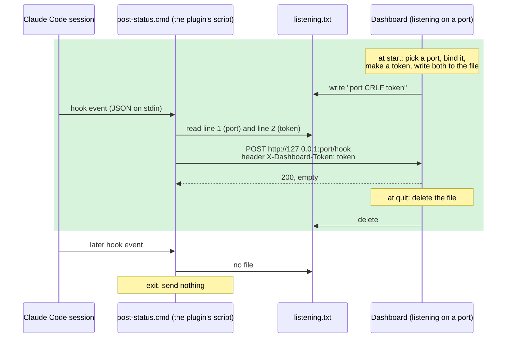
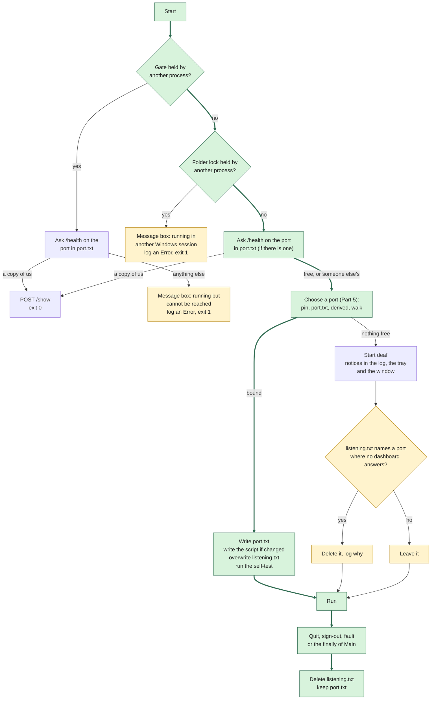

# Claude Dashboard: how Claude Code reaches the dashboard

2026-10-12, updated 2026-10-13 · the mechanism as built. Parts 9 to 11 record what was decided on 2026-10-12 (issues #150 and #151) and built in T1.86 (PR #153, merged as `f568976` on 2026-10-13).

This page is for someone who sits down cold and wants to understand how a Claude Code session's events get to the dashboard window, what can go wrong on the way, and what the dashboard does about it. Every statement about the behaviour was checked against `main` at `91995cc` and, for what T1.86 changed, at `f568976`; the file and section names point at the code and the Implementation Specification (Impl) for the detail.

## Words used here

| Word | Meaning on this page |
|---|---|
| **Hook** | A moment in a Claude Code session (a prompt is sent, a turn ends) at which Claude Code runs a command you registered, handing it the event as JSON. |
| **Plugin** | Claude Code's packaging for hooks and the like: a folder of files that Claude Code loads, recorded in the user's Claude Code settings. The dashboard's hook is delivered as a plugin. |
| **Loopback** | The network address `127.0.0.1`: this computer talking to itself. Nothing leaves the machine. |
| **Port** | A number from 1 to 65535 that a program listens on. **Ports are machine-wide:** any program on the PC, in any user's sign-in, can take a free one or connect to a taken one, and nothing in Windows says whose it is. |
| **Bind** | To take a port for listening. Only one program can hold a port at a time; the second one to try gets an error. |
| **Token** | A 43-character random secret the dashboard makes at each start and keeps in a file only your own processes can read. A message without it is refused, so a program that can reach the port but not your profile cannot use the dashboard. |
| **Data folder** | `%LOCALAPPDATA%\ClaudeDashboard\` (or wherever `CLAUDE_DASHBOARD_HOME` points). Everything the dashboard owns lives here, per Windows user (Impl §8.1). |
| **Gate** | A Windows named mutex the dashboard takes at start so that one sign-in runs one dashboard (Part 6). |

## 1. The whole thing in one picture



Green is the ordinary day: the dashboard starts and announces itself, every event reaches it, and it withdraws the announcement when it quits. After that the hook finds no file and does nothing, which is also by design.

There are two moving parts, and a file between them:

- **The plugin's script** (`post-status.cmd`) is run by Claude Code at each hook event. It reads `listening.txt`, which sits beside it, and posts the event to the port on line 1 with the token on line 2. No file, it sends nothing and exits.
- **The dashboard** chooses a port, binds it, makes a token, and writes both into `listening.txt`. When it quits, it deletes the file.

Everything else on this page is about keeping that file true: it must name a dashboard that is really listening, and only one.

## 2. Claude Code hooks, as far as this needs them

Claude Code can run a command of yours at certain moments in a session and give it the event as JSON on standard input. The dashboard registers one command for eight of those moments: a session starts, you send a prompt, Claude needs you (a permission question, or it is waiting), Claude finishes a turn, a turn fails, a batch of tool calls finishes, the session changes folder, the session ends.

Three things about the dashboard's command matter here, and nothing else about hooks does:

- **It is a pointer, installed once.** The hook names `post-status.cmd` in the data folder by its absolute path. It never carries a port or a token. That is why the dashboard can change port or token at any start without touching Claude Code's settings.
- **It is delivered as a plugin.** The plugin's five files live in the data folder at `plugin\`. The dashboard asks Claude Code to register it (`claude plugin marketplace add`, `claude plugin install`), and Claude Code records that in the user's own `~/.claude/settings.json`. **The dashboard reads that file and never writes it** (Impl §9.3, §9.4). The plugin is per Windows user, so every Claude Code session of that user, in any folder, runs the same script.
- **It can never affect a turn.** The script prints nothing and always exits 0. Output from a hook would land in the model's context as if you had typed it, and a non-zero exit would be reported or would block the turn. The dashboard is an observer only.

## 3. The message: HTTP on loopback, with a token

The script sends one HTTP request per event: `POST http://127.0.0.1:<port>/hook`, the event JSON as the body, and the token in the header `X-Dashboard-Token`. It uses `curl.exe` from `System32`, waits at most 1 second to connect and 2 in all, and throws the answer away. The dashboard answers `200` with an empty body, always. Impl §3.2 lists the endpoints; §3.4 is the security.

**Why a port.** Loopback HTTP is the one channel a batch file, a Node module (the usage mod) and a .NET process all speak. The cost is that a port is machine-wide and anonymous: nothing says it is the dashboard's, and any program can take it or send to it.

**Why a token.** The port is open to the whole machine, but the file is not. `listening.txt` is in your profile, and the folder takes the profile's permissions: you, Administrators and SYSTEM (Impl §8.1). So a process can read the token only if it runs as you, as an administrator who has elevated, or as SYSTEM. Claude Code, the script and `curl.exe` all run as you, so they read the token and their posts are accepted. A program in another user's sign-in can reach the port but cannot read the file, so everything it posts is refused with `401`; the only thing it can get is `/health`. Without the token, another user on the machine could feed your dashboard invented events (a fake "finished", a forged acknowledgement) or read `/state`, which carries your session names and folders. The token carries the line Windows already draws around your profile from the file to the port. **It does not protect against a program running as you:** anything you run can read the file as the script does (`IngressToken.cs` states this as the model).

The token is 32 random bytes written as 43 characters, new at every start, held in memory and written to `listening.txt` and nowhere else: never to the log, never to the environment, never to a committed file. `port.txt` holds only the number, which is not a secret. A post with a wrong or missing token gets `401`, is counted, and after three in ten minutes the window shows *Messages from Claude Code are being refused*. Because the script reads the token from the file at every event, a session never holds a copy, and a dashboard restart cuts nobody off (Impl §3.4).

**One endpoint has no token: `GET /health`.** It answers `{"status":"ok","instance":"<gate name>"}`. It exists so that a starting dashboard can ask whoever holds a port *who are you*; a token would defeat that, since another dashboard's token is exactly what the asker cannot have (Part 6).

## 4. The two files

Both are in the data folder. They hold the same number and mean two different things (Impl §8.1; `DashboardPaths.cs`).

| | `port.txt` | `listening.txt` |
|---|---|---|
| **Content** | One line: a port | Line 1: the port. Line 2: the token. CRLF between, nothing after |
| **Means** | "This user's dashboard was last on this port." A memory | "A dashboard is listening on this port **right now**, and accepts this token." A statement |
| **Written** | After a bind | After a bind, after the script is written, by write-then-rename so a reader never sees half a file |
| **Deleted** | **Never** | At every exit: the ordinary quit, a Windows sign-out, a fault that stops the process, and the `finally` of `Main` |
| **Read by** | The next start (first port to try); a second start (where to send `/show`) | The script at every event; the usage mod; a second start (the token for `/show`) |
| **Absent means** | Fresh profile: derive a port | **No dashboard: send nothing.** This is how the hook stays installed while the dashboard is closed, with no error on every turn |

Why not one file: `port.txt` must outlive the process so the user keeps the same port across restarts and a second start can find the first one; `listening.txt` must *not* outlive the process, because its presence is the signal. One file cannot do both. The price is that after a hard stop they disagree: `port.txt` is still right and `listening.txt` is stale (Part 8).

## 5. Finding a port

**Why per user.** The port is machine-wide; everything else the dashboard owns is per user. With one fixed port, the first user to sign in takes it and every other user's dashboard hears nothing, with no error (issue #5). So each user gets a port of their own, chosen like this (Impl §3.1; `PortSelection.cs`, `Program.ChoosePort`):

| Step | Candidate | If it is taken |
|---|---|---|
| 0 | **The pinned port**: `"port"` in `settings.json`, if set | **Stop.** No other port is tried. The dashboard starts deaf and says so (below) |
| 1 | **`port.txt`**: the port this user had last time | Go on |
| 2 | **The derived port**: `52789` + (SHA-256 of the user's SID, first four bytes, mod 1000). So 52789 to 53788, the same number for the same account on every start and every machine | Go on |
| 3 | **The walk**: the next 32 ports above the derived one, wrapping inside the 1000 | After 32, stop: deaf start |

On this machine the operator's account derives 52888.

**"Trying" means binding.** For each candidate the dashboard opens a listener on `127.0.0.1:<port>` and closes it again. Success means free: Kestrel binds it for real a moment later. Failure means taken, and then the dashboard asks `GET /health` on that port, with a one-second limit, to learn who holds it:

| `/health` says | Called | What the start does |
|---|---|---|
| Connection refused after all | Free | Take it |
| `ok` with **our** gate name | A copy of us | Send `/show` to it and exit (Part 6) |
| `ok` with another gate name | Another dashboard (another sign-in, or another data folder) | Skip it; not ours to use or to signal |
| Anything else: another status, not JSON, not 200 | A stranger | Skip it |
| Connected, no answer in a second | Silent | Skip it |

**The pin is different on purpose.** An operator who writes a port in `settings.json` has usually made it a contract with something outside the dashboard: a firewall rule, a script, a bookmark. Moving them off it quietly would turn the setting into a suggestion. So a taken pin is a visible fault, not a fall-back.

**No free port: the dashboard starts anyway, deaf.** It shows its window and plays no tricks; it says what is wrong in three places (Impl §3.1): an Error line in the log, the first line of the tray tooltip, and the first line of the window's notice row. With no pin: `port <n> taken · free a port and restart`. With a pin: `pinned port <n> taken · unpin it or free it, then restart`. **Nothing retries:** no event says a port became free. And a deaf dashboard **writes no `listening.txt`**: the file would point the hooks, and your prompts, at whatever holds that port.

After a successful bind the dashboard writes `port.txt`, rewrites the script if the build changed it, writes `listening.txt`, and then runs the script itself once as a self-test (Impl §9.4): the test message must arrive within 3 seconds or the window says *Messages from Claude Code cannot reach the dashboard*.

## 6. The gate: one dashboard per sign-in

**The gate is a Windows named mutex**: a lock with a name that any process can ask the operating system for, and that one process at a time can hold. The dashboard asks for

```
Local\ClaudeDashboard.SingleInstance.<16 hex characters>
```

where the hex is a hash of two things: the data folder path and the Windows sign-in session number. The first dashboard to ask holds it until its process ends, however it ends. Windows releases a mutex the instant its holder dies, so a crashed dashboard never blocks the next start, and there is nothing to clean up (`SingleInstanceGate.cs`; Impl §5.3).

**A second start in the same sign-in** is told "held". It then reads `port.txt`, asks `/health` on that port, and if the answer carries its own gate name, it sends `POST /show` (with the token from `listening.txt`) so the running dashboard raises its window, and exits. You double-clicked the shortcut; the window you already had comes forward. If `/health` answers anything else (the first copy is starting, stopping, or deaf) the second one writes one Error line to the log and exits without starting a rival: two dashboards on one database is the thing the gate exists to prevent.

**Two interlocks, one authority.** The gate decides "a copy of me is running". The port only corroborates, by carrying the gate name in `/health`. After a hard stop anything may hold the old port, so "the port is taken" never by itself means "another copy of me", and a dashboard that holds the gate but finds a copy of itself answering on its recorded port still sends `/show` and exits: the name decides, not the mutex alone (`StartupDecision.cs`).

**Why the sign-in is part of the name.** A second Windows sign-in as the same user gets a different name, so its own gate, so its own dashboard. Deliberately: otherwise the second sign-in would be told "already running" and have the window raised on a desktop it cannot see. The consequence is the one case where two dashboards share one data folder (scenarios 7 and 8 in Part 8).

**When a second sign-in as the same user can exist.** Not on Windows 10 or 11 Pro in normal use: a client edition allows one session per account. Connecting by Remote Desktop as the account that is signed in at the keyboard moves that same session to the remote connection and locks the screen at the keyboard; you return to your own desktop, processes and dashboard. Two live sessions for one account need Windows Server with the "restrict each user to a single session" setting turned off, or a third-party change to a client edition. What a client edition does allow is two *different* users with live sessions (one at the keyboard, one remote or switched away); each has their own profile, so their own data folder and files, and only the port is shared, which the walk handles (scenario 5).

## 7. The start and the exit, as built



Green is the ordinary start: the gate and the folder lock are free, nothing of ours answers on the recorded port, the first candidate binds, the dashboard runs, and a clean quit removes the file. Amber is what T1.86 added (Part 9): the folder lock's question, the two message boxes and the deaf-start tidy-up. Every other box is a start that found something in the way.

Three points to hold on to: **a bound dashboard overwrites `listening.txt` unconditionally**, which is what corrects a file a crash left behind; **every exit deletes it**, and since there is one dashboard per data folder the file is always its own; and **a deaf dashboard never writes the file**, but removes a stale one when nobody answers on the port it names.

## 8. What can go wrong, and what the dashboard does

The verdicts are as of T1.86 (`f568976`). Where T1.86 changed the behaviour, the row says what happened before.

| # | Situation | What happens | Verdict |
|---|---|---|---|
| 1 | You start the dashboard a second time in the same sign-in | The gate catches it; `/show` raises the window you had; the second process exits. The file is untouched | Fine |
| 2 | The dashboard crashes or is killed, you restart it, the port is free | `listening.txt` is stale until the restart; each event in between costs the script a connect that fails in under a second, async, nothing waits. The restart binds the same port (`port.txt`) and overwrites the file with a new token | Fine |
| 3 | Crash, and before the restart **another program takes the port** | Every event posts your prompt and the dead token to that program. No pin: the restart walks to a free port and overwrites the file; the leak lasts until the restart | Acceptable; recorded in Impl §9.4 as the residual |
| 4 | Crash, **the pinned port is taken**, restart | The restart is deaf and shows the notices. Its probe finds no dashboard on the pinned port, so it removes the stale file, and the leak ends at the restart as in #3. **Before T1.86** the file stayed, and the leak lasted as long as the deaf dashboard ran | Closed by T1.86 (#151). It was the one gap reachable on a PC |
| 5 | Another user is signed in and their dashboard holds your derived port | `/health` says "another dashboard"; the walk skips it. Their file is in their folder, not yours | Fine; this is what the walk is for |
| 6 | A stranger (a dev server) holds your recorded or derived port, no pin | Skipped; the walk finds the next free port; `port.txt` is updated | Fine |
| 7 | **You are signed in twice as the same user** (Windows Server with one-session-per-user off; not reachable on Windows 11 Pro, see Part 6), both start a dashboard, no pin | Copy 2 finds the folder lock held and its own gate free: a message box, *already running in another Windows session*, and exit. One dashboard, one database, one file. **Before T1.86** copy 2 walked past copy 1's port, overwrote `listening.txt`, took every hook, and deleted the file when it quit; copy 1 heard nothing and nothing told it | Closed by T1.86 (#150) |
| 8 | Signed in twice, **with a pin** | The same as #7: the lock is checked before the port, so the pin never enters into it. **Before T1.86** copy 2 started deaf and deleted copy 1's file when it quit | Closed by T1.86 (#150) |
| 9 | The running dashboard has hung | It still holds the gate, and `/health` may still answer. A new start sends `/show` (the window may not come), or shows the *could not be reached* box and exits. **Before T1.86** that exit wrote one line in the log file and showed nothing | By design, now visible. End it in Task Manager; the next start is a first start |
| 10 | You delete `listening.txt` by hand while the dashboard runs | Every hook finds no file and sends nothing until a restart | Minor, unchanged. Delete the file only on purpose; quitting the dashboard is the way to silence the hooks |

Before T1.86, in #7 and #8 the two copies also wrote one `dashboard.db`. The folder lock makes that impossible (Part 10).

## 9. What was decided and built: one dashboard per data folder

An earlier draft of this part let two dashboards share the file, warned the loser every 15 seconds, and had each delete only its own file. A review on 2026-10-12 made two points: the owner check has a race (read "mine", the other dashboard writes, delete theirs), and the whole arrangement was a graceful way of doing something the product should refuse. The operator chose the refusal, and T1.86 built it (PR #153, merged as `f568976` on 2026-10-13). The design is three sentences:

**One dashboard per data folder. A bound dashboard overwrites a stale announcement. A deaf dashboard removes one when nobody answers on its port, and never writes one of its own.**

| Moment | Before T1.86 | Since T1.86 | Why |
|---|---|---|---|
| Start | The gate: one dashboard per sign-in (Part 6) | **A folder lock as well:** a second named mutex, `Global\ClaudeDashboard.DataFolder.<hash of the folder>`, taken right after the gate and before anything writes the folder. Gate held → a copy in this sign-in → `/show` and exit, as before. Gate free, folder lock held → a copy in another sign-in → exit without starting. Both free → start | Two dashboards on one folder share one database and one file. Refusing is the one exception Part 6 already makes, applied across sign-ins |
| A second start that exits without showing a window | One line in the log file | **A message box too**, then exit. *Already running in another Windows session for this account; quit it there, or end its process.* Or: *already running, but it could not be asked to show its window; open it from its tray icon, or end its process.* Each names the logs folder (the log file's name carries the date) | You double-clicked and nothing happened. The log line stays |
| Bound a port | Overwrite `listening.txt` | Same | Corrects a crash's leftover |
| Deaf start (pin taken, or the walk ran out) | Leave the file | Still write nothing. **Remove the file if no dashboard answers on the port it names** (free, a stranger, or silent); keep it if one does | Scenario 4, the one gap you can reach on a PC |
| Quit | Delete the file | Same | With one dashboard per folder, the file is always its own |

The start as built is the diagram in Part 7; its amber boxes are what this part added. Part 8 gives each scenario before and after.

**What does not change:** the gate; the port choice and the meaning of a pin; `port.txt` is never deleted; a bound dashboard overwrites the file; the token stays in memory and in the file and is never logged (the tidy-up reads line 1 and never line 2). And the day-to-day case: a running dashboard, a second start, its window comes forward.

**Considered and not built:**

- A check of the file every 15 seconds, and a notice *another dashboard took the hooks*: only needed when two dashboards share a folder, which the lock forbids.
- Deleting the file only when it holds my token: the same, and it carried the race above.
- A lock around the file operations: with one dashboard per folder there is no second writer to lock against.
- Rewriting a file someone deleted by hand: little value, one more moving part.

## 10. Not supported (Impl §5.3)

- Two sign-ins as the same account sharing one data folder (Windows Server): the second dashboard does not start and says so.
- A different account pointed at the same folder through `CLAUDE_DASHBOARD_HOME`: the folder lock cannot be opened across accounts, so the dashboard starts and logs that sharing a folder between accounts is not supported.

## 11. Where it landed

Issues **#150** (the folder lock and the message box) and **#151** (the deaf-start tidy-up); task **T1.86** in the Execution Plan; PR #153, five commits, merged as `f568976` on 2026-10-13 after two reviews (the first asked for one test, the second found nothing).

- `DataFolderLock`, a sibling of `SingleInstanceGate` with the same normalisation (now shared) and no session in its name. A lock that cannot be created or opened is "cannot tell": the start goes on with one Warning.
- `StartupDecision.For(holdsGate, holdsFolder, occupant)`: the folder bit and the action `ExitForOtherSession`, with no probe and no `/show`.
- `StandDownNotice.TextFor`: the two texts as a pure function. `Program.Run(args, showBox)` takes the box as a required argument, and `Program.Main` is the Velopack call and `return Run(args, ShowMessageBox)`. Two guard tests hold it: `MessageBox.Show` appears in `Program.cs` only, once; no test calls `Program.Main` except with a literal hook switch. The task's first Debug run was blocked by a real box from a test that runs the real start; that is why the box is an argument and not a default.
- `IngressAnnouncement.RemoveStale`: the deaf-start tidy-up, one probe of the port on line 1 with the walk's classifier; `OurInstance` and `OtherInstance` keep the file, anything else deletes it. Line 2 is read with the rest of the file and never used or logged. `ListeningFile` changed only in its remarks.
- Tests: 55, among them `OtherSessionStartTests`, which runs the real start with the folder lock held on another thread and holds four claims at once: exit 1, one box, no request to the recorded port, no `listening.txt`. The review asked for it: without it, ignoring the lock in `Program` left every test green.
- Documents: Impl §3.1, §5.3, §8.1, §9.4 and one Appendix C row; the event flow, three rows; the remarks in `SingleInstanceGate`, `IngressAnnouncement`, `ListeningFile`, `StartupDecision` and `Program`.
